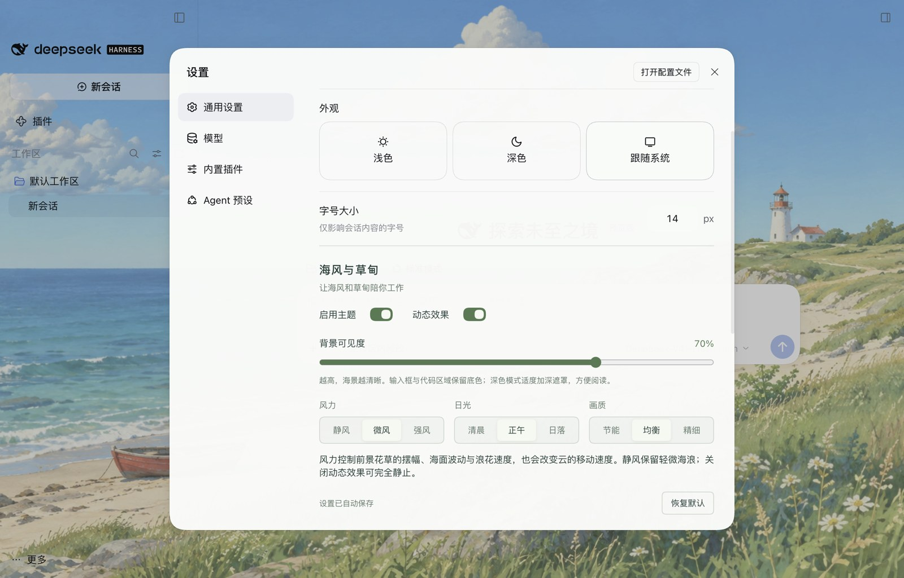

# 海风与草甸 · Open Meadow

适用于 **官方 macOS DeepSeek Harness 0.2.0-rc.2** 的动态海边主题。
当前为 **1.0.0-preview.3 预览版**，不是最终正式版。

## 功能

- 本地手绘海景：漂移云层、局部海面纹理和移动浪花、三簇前景花草摆动。
- 静风、微风、强风控制花草摆幅、水面波动、浪花速度和云速。
- 清晨、正午、日落，以及节能、均衡、精细三档画质。
- 背景可见度默认 70%，可在 10%～95% 调整；输入框、代码、菜单保留阅读底色。
- 全中文设置，直接嵌入 **设置 → 通用设置 → 海风与草甸**，没有浮动按钮。
- 动态可独立关闭；页面隐藏、系统减少动态效果时停止循环。设置自动保存在本机。



## 安装

使用官方插件命令安装预览版本；仓库包含构建好的运行文件，安装时无需编译。

```sh
dsh plugin --profile desktop add github:zhongyichang1998/dsh-open-meadow#v1.0.0-preview.3
```

重新打开客户端，在 **设置 → 通用设置 → 海风与草甸** 中调整。
若你的桌面版没有将 dsh 加入 PATH，可使用应用内置 CLI：

```sh
"/Applications/DeepSeek Harness.app/Contents/Resources/runtime/cli/bin/dsh" plugin --profile desktop add github:zhongyichang1998/dsh-open-meadow#v1.0.0-preview.3
```

卸载：`dsh plugin --profile desktop remove dsh-open-meadow`。
停用主题会撤销自己的样式、主题 Token 和背景，不修改应用或 app.asar。
请只启用一套背景主题；检测到已知背景冲突时会暂停自身。

## 验证与边界

本版本通过 7 项基础测试、16 项浏览器外壳回归，以及真实官方 DSH 的 12 项隔离检查。
真实客户端分区验证海水、花丛和草丛都在运动；船、灯塔与前景大岩石区域保持固定。
三档风力另有 0～4 秒、11 个固定时间点的独立分区比较，证据在 artifacts/。
原生截图来自无账号、无聊天的隔离测试环境。

前景使用局部图像剪切近似，没有逐株植物骨骼；远景草甸仍静止。
底图为 1672×941，云边还需精修；Intel Mac、其他宿主版本、长期负载与整机功耗尚未验证。
完整限制见 [已知问题](docs/KNOWN_ISSUES.md)。

主题不读取聊天、账号、API Key 或外部工作文件，无遥测、运行时 CDN 或图片服务。
图片随插件打包；生产美术为 AI 生成，说明见 [美术记录](docs/ART_DIRECTION.md)。

## 开发

```sh
npm install
node scripts/build.mjs
node --test tests/*.test.mjs
npx playwright install chromium
node scripts/browser-test.mjs
node scripts/motion-test.mjs
node scripts/pack.mjs
```

源码在 src/，生成文件在 plugin/client.js 与 dist/。
浏览器外壳只用于兼容性测试；原生检查脚本需要官方 macOS 应用及专用的隔离 profile。

## 许可

MIT。静态路由及部分壳体选择器参考 Open Sea Skin，并保留其 MIT 署名。
详见 [第三方与美术说明](THIRD_PARTY_NOTICES.md)。原始私人参考素材不在本仓库或安装包内。
